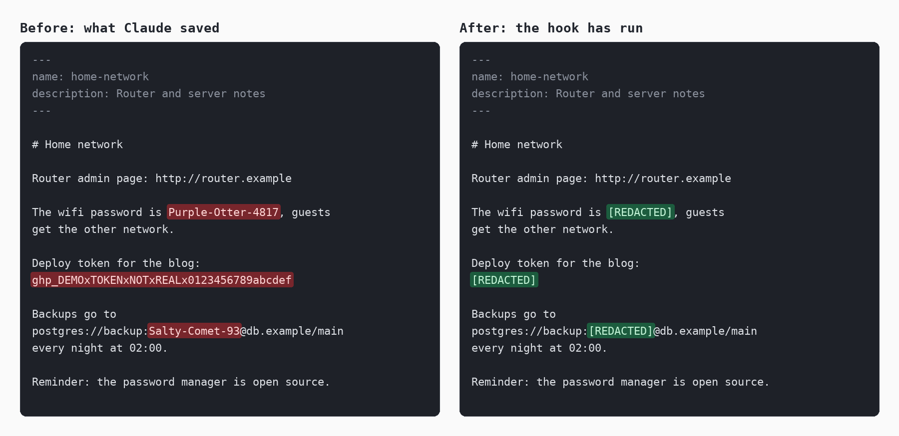

<p align="center"></p>

# claudepassredactor

[English](README.md) | **Español**

Un hook para [Claude Code](https://code.claude.com/docs) que cambia contraseñas y tokens por `[REDACTED]` en sus notas de memoria. Si le das una contraseña a Claude y acaba guardada en un fichero `.md` de la memoria, el hook la tapa, ahí y en cualquier otra nota.

Es un solo fichero de Python sin dependencias. De lo que escribes solo guarda huellas con clave, nunca el texto. Es un proyecto independiente, sin relación con Anthropic ni respaldado por ella.

> **Es una red de seguridad, no una bóveda.** Quita los secretos de las notas de memoria después de que lleguen a ellas. Para entonces el secreto ya ha pasado por la conversación y está en el transcript. Si el secreto importa, cámbialo. Consulta [Qué no garantiza](#qué-no-garantiza).

## Qué tapa

Solo en ficheros Markdown dentro de las carpetas de memoria:

| Qué | Ejemplo | Cuándo |
|---|---|---|
| Secretos que hayas dado en un mensaje, reconocidos allí por etiqueta o formato | `Hunter-2024x`, que luego se encuentra aunque no lleve etiqueta al lado | Los valores fuertes, en cualquier sitio; los PIN y valores cortos, solo si poco antes, en la misma frase, hay una palabra como *contraseña* o *PIN* |
| Tokens con formato conocido | GitHub, GitLab, Anthropic, OpenAI, xAI, Groq, Perplexity, Replicate, Stripe, Square, Shopify, Twilio, Slack, Discord, AWS, Azure Storage, Google, npm, PyPI, Hugging Face, SendGrid, Mailgun, Mailchimp, Telegram, DigitalOcean, Supabase, Databricks, Doppler, Postman, Atlassian, Notion, Linear, Grafana, New Relic, Sentry, Tailscale, claves age, JWT, cabeceras `Authorization`, claves privadas PEM y PGP | Siempre, aunque no vengan de tus mensajes |
| Valores con etiqueta | `contraseña: X`, `DB_PASSWORD=X`, `"password": "X"`, celdas de tabla, `API_KEY=X` | Si X parece un secreto: al menos 8 caracteres mezclando letras con cifras o símbolos, o 8 cifras o más |
| Contraseñas en URL | `postgres://usuario:X@host`, `redis://:X@host` | Si X es fuerte o tiene al menos 8 letras; el `123456` de un manual se queda salvo que lo hayas dado tú |
| Valores aleatorios con cualquier nombre | `HSID=X` en una cookie copiada, `GRAFANA_AUTH=X` en un comando | Si X parece aleatorio: 16 caracteres o más mezclando mayúsculas, minúsculas y cifras. Se dejan los nombres de identificadores, versiones, hashes, rutas y hosts, y los valores que son fechas, nombres de fichero, hashes o nombres con guiones bajos |

**Idiomas.** Las etiquetas se reconocen en 15 idiomas: inglés, español, portugués, francés, alemán, italiano, neerlandés, polaco, ruso, ucraniano, chino simplificado, japonés, coreano, tailandés e hindi. Por ejemplo *mot de passe : X*, *Das WLAN-Passwort lautet X*, *пароль — X*, *密码是X*, *パスワードはXです*, *비밀번호는 X입니다*, *รหัสผ่านคือ X*, *मेरा पासवर्ड X है*. Los mensajes del hook y de los comandos salen en esos mismos idiomas.

**Se deja en paz a propósito:** «la contraseña es incorrecta», «gestor de contraseñas: Bitwarden7», `password: <your-password>`, `${DB_PASS}`, nombres de variables de entorno, rutas, versiones, direcciones IP, fechas, palabras normales y cualquier fichero que no sea Markdown.

## Qué no garantiza

- **El secreto ya ha viajado.** Tu mensaje ha llegado al proveedor del modelo y está en el transcript de la conversación (`.jsonl`), que esta herramienta no toca. Tapar una nota no deshace el envío.
- **Las copias de otros sitios se quedan.** Las copias de seguridad, los servicios de sincronización, el historial de git y otros ficheros y carpetas conservan lo que ya tengan. Si tu carpeta de memoria es un repositorio git, los commits viejos siguen teniendo el secreto.
- **Hay un retraso.** Una nota se tapa justo después de que una herramienta de ficheros la escriba o, si no, en el siguiente comando de terminal o mensaje. Hasta entonces el secreto está en el disco, y Claude puede haberlo leído.
- **La detección es heurística.** Se le escaparán cosas. Consulta [Limitaciones](#limitaciones).
- **Las huellas no son cifrado.** Con la clave y las huellas juntas, un atacante puede probar valores sin conexión, y un PIN de 4 cifras cae enseguida. Por eso están en una carpeta privada; no la sincronices ni la subas a un repositorio.
- **Tapar no se puede deshacer.** El valor original no se guarda en ninguna parte. Ejecuta `scan` antes si tienes dudas, y conserva tu propia copia de lo que no quieras perder.

## Instalación

Necesitas Python 3.9 o posterior. El hook no envía nada por la red.

**1. Consigue el fichero y cópialo.** Está en el repositorio <https://github.com/javimentallab/claudepassredactor>: clónalo, o descarga solo `claudepassredactor.py`.

```sh
git clone https://github.com/javimentallab/claudepassredactor
cd claudepassredactor
mkdir -p ~/.claude/hooks
cp claudepassredactor.py ~/.claude/hooks/
```

En Windows, cópialo en `C:\Users\<tú>\.claude\hooks\`.

**2. Registra los hooks** en `~/.claude/settings.json`, junto a los `hooks` que ya tengas. Usa la ruta completa del fichero, y `python` en vez de `python3` en Windows, aquí y en los comandos de abajo:

```json
{
  "hooks": {
    "UserPromptSubmit": [
      {
        "hooks": [
          { "type": "command", "command": "python3 -I /home/tu/.claude/hooks/claudepassredactor.py prompt", "timeout": 20 }
        ]
      }
    ],
    "PostToolUse": [
      {
        "matcher": "Write|Edit|MultiEdit|Bash|PowerShell",
        "hooks": [
          { "type": "command", "command": "python3 -I /home/tu/.claude/hooks/claudepassredactor.py memory", "timeout": 20 }
        ]
      }
    ]
  }
}
```

En Windows, escribe la ruta con barras normales: `python -I C:/Users/<tú>/.claude/hooks/claudepassredactor.py prompt`. Claude Code ejecuta el comando con Git Bash, que elimina las barras invertidas fuera de las comillas, así que el hook busca un fichero que no existe aunque el tuyo sí exista. Entre comillas dobles, una ruta con barras invertidas funcionó al probarla, pero `status` avisa igualmente de cualquier barra invertida.

**Si la ruta está mal, tus mensajes quedan bloqueados.** Python no puede abrir el fichero y termina con código 2, y Claude Code bloquea el mensaje al recibir ese código. No llega nada a Claude, y pasa lo mismo con cada mensaje, así que no puedes usar Claude Code hasta corregir `settings.json`. Lo reconoces por este texto en lugar de una respuesta, tal como lo mostró `claude -p` en Windows con Claude Code 2.1.316, con código de salida 0:

```text
UserPromptSubmit operation blocked by hook:
[python -I "C:/wrong/path/claudepassredactor.py" prompt]: C:\Python311\python.exe: can't open file 'C:\\wrong\\path\\claudepassredactor.py': [Errno 2] No such file or directory


Original prompt: your message
```

Para arreglarlo, abre `~/.claude/settings.json` en un editor de texto, corrige la ruta y vuelve a arrancar Claude Code; él no puede hacer el cambio mientras tus mensajes estén bloqueados. Después ejecuta `status` en una terminal: avisa de una barra invertida y de un fichero que no existe.

`-I` impide que Python cargue módulos de la carpeta actual o de las variables `PYTHON*`, para que un fichero plantado no pueda ejecutarse dentro del hook.

**3. Compruébalo**

```sh
python3 ~/.claude/hooks/claudepassredactor.py status   # carpetas, clave, huellas, rutas de los hooks
python3 ~/.claude/hooks/claudepassredactor.py scan     # lo que cambiaría hoy; no cambia nada
```

La clave se crea con el primer mensaje. Para tapar lo que ya esté en tus notas, ejecuta `redact` cuando te convenza lo que lista `scan`.

**Opcional:** para revisar las notas también al empezar una sesión, añade una entrada `SessionStart` con el mismo comando que `PostToolUse` (modo `memory`) y sin matcher.

## Desinstalar y revertir

1. Quita sus entradas de `~/.claude/settings.json`. Hazlo lo primero: mientras falte el fichero del hook `prompt`, Claude Code bloquea tus mensajes.
2. Borra `~/.claude/hooks/claudepassredactor.py`.
3. Borra sus datos, clave incluida: `~/.claude/claudepassredactor/`, y el fichero compartido si definiste `CLAUDEPASSREDACTOR_SHARED`.

Tus notas se quedan como están. **El texto ya cambiado por `[REDACTED]` no vuelve**, porque la herramienta nunca lo guardó: si lo necesitas, recupéralo de tu propia copia de seguridad. Para dejar de tapar un valor sin desinstalar, ejecuta `forget`, que lo pide sin mostrarlo en pantalla. No restaura las notas ya cambiadas.

## Cómo funciona

```
tu mensaje ──► hook prompt ──► ¿parece un secreto? ──► guarda solo HMAC-SHA256
                                                       (key.bin no sale de este equipo)
                   │
                   ▼
Claude escribe una nota ──► hook memory ──► revisión ──► cambia lo encontrado, de forma atómica
```

- **Huellas.** Un secreto de tu mensaje se guarda como HMAC-SHA256 con una clave aleatoria de 256 bits. Para encontrarlo después, la revisión calcula la huella de los candidatos en cada borde de palabra de una nota que ha cambiado, para cada longitud guardada.
- **Dónde está cada cosa.** Por defecto en `~/.claude/claudepassredactor/`, fuera de las carpetas de memoria: `key.bin`, `fingerprints.json`, `state.json`, `redactor.log`. La carpeta y los ficheros son privados de tu usuario: modo `0700`/`0600`, o una ACL equivalente en Windows.
- **Qué carpetas.** Todas las `~/.claude/projects/*/memory`, `~/.claude/agent-memory` y `autoMemoryDirectory` de tus ajustes de **usuario**. Los ficheros de ajustes de proyecto no se leen a propósito, para que un repositorio clonado no pueda apuntar la herramienta a otras carpetas con esa opción. (Un repositorio en el que confías ya puede ejecutar sus propios hooks, así que esto no es un aislamiento.) Si usas esa opción en un proyecto, pon la carpeta en `CLAUDEPASSREDACTOR_DIRS`.
- **Las escrituras son atómicas.** Una nota se escribe en un fichero temporal, se vuelca al disco y se intercambia. Si algo falla, el original queda entero y la siguiente pasada lo vuelve a intentar. No hay ninguna alternativa que escriba sobre el fichero.
- **Un hook en marcha nunca te bloquea.** Siempre termina con código 0. Los problemas van al log y aparecen una vez, como un aviso corto que te pide ejecutar `status`. Una ruta mal escrita es distinta: el hook no llega a arrancar y Claude Code bloquea tus mensajes. Consulta [Instalación](#instalación).
- **El log no guarda datos.** Apunta recuentos, nombres de fichero, números de línea y tipos de coincidencia; de los errores, solo tipo, código y línea.

## Comandos

```sh
python3 claudepassredactor.py scan            # lista coincidencias, nunca los valores; código 1 si hay alguna, 2 si hay un aviso o una nota ilegible
python3 claudepassredactor.py scan --context  # además cada línea, con todas las coincidencias tapadas
python3 claudepassredactor.py scan --all      # también las carpetas ocultas, salvo .git
python3 claudepassredactor.py redact          # revisa todas las notas ahora
python3 claudepassredactor.py redact --all    # también las carpetas ocultas, salvo .git
python3 claudepassredactor.py status          # carpetas, estado de la clave, huellas, rutas de los hooks
python3 claudepassredactor.py add             # recuerda un valor, que se pide sin mostrarlo
python3 claudepassredactor.py forget          # deja de buscar un valor
python3 claudepassredactor.py reset --yes     # borra la clave y las huellas de este equipo, no el fichero compartido
```

`scan` y `redact` miran las mismas notas: por defecto se saltan las carpetas ocultas, como los hooks, y `--all` las incluye.

`add` sirve para proteger un valor **sin contárselo a Claude**, o uno que la detección no ve, como una frase de paso con espacios. `scan --context` imprime el resto de cada línea: ahí aparecería un secreto que no haya reconocido, así que lee esa salida tú en vez de pegarla en una conversación.

| Variable | Significado |
|---|---|
| `CLAUDEPASSREDACTOR_DIRS` | Carpetas que revisar, como rutas absolutas, separadas por `:` (`;` en Windows). Sustituye a las de por defecto. Se rechaza una unidad, tu carpeta personal o la propia carpeta de Claude, con un aviso. |
| `CLAUDEPASSREDACTOR_DATA` | Dónde están la clave, las huellas, el estado y el log, como ruta absoluta. |
| `CLAUDEPASSREDACTOR_SHARED` | Fichero que mantiene las huellas iguales entre equipos, como ruta absoluta. Desactivado por defecto. |
| `CLAUDEPASSREDACTOR_LANG` | Idioma de los mensajes, como `de` o `zh-CN`. Por defecto, el del sistema. |
| `CLAUDE_CONFIG_DIR` | La carpeta de Claude, si no es `~/.claude`. |

**Dónde definirlas.** En el bloque `env` de `~/.claude/settings.json`, para que Claude Code se las pase a los hooks:

```json
{
  "env": {
    "CLAUDEPASSREDACTOR_SHARED": "/home/tu/sync/claudepassredactor.json"
  }
}
```

Los comandos que ejecutas tú en una terminal no leen ese bloque: para que usen los mismos ajustes, define las variables también allí.

**Varios equipos.** Cada instalación tiene su propia clave y sus huellas, así que un secreto escrito en una no se conoce en las demás; la detección por formato y por etiqueta funciona igual en todas. Para compartirlas, copia `key.bin` a cada equipo por una vía privada y haz que `CLAUDEPASSREDACTOR_SHARED` apunte en todos al mismo fichero, en una carpeta que mantenga sincronizada una herramienta tuya, como Syncthing. No uses una carpeta que se sincronice con terceros ni dejes ahí la clave: con la clave y las huellas juntas, un atacante puede probar contraseñas. Las copias de conflicto de Syncthing se unen y se borran, `forget` llega a los demás equipos, y un fichero hecho con otra clave se deja como está y lo avisa `status`. `reset` no borra el fichero compartido, porque lo usan los demás equipos, y lo dice por pantalla; para seguir compartiendo, vuelve a copiar `key.bin` desde otro equipo.

## Limitaciones

- Solo ficheros `.md`, y solo dentro de las carpetas de memoria. Los enlaces dentro de una carpeta de memoria no se siguen, así que una nota a la que se llega por un enlace no se revisa, salvo que su ubicación real también esté en una carpeta de memoria.
- **Las palabras sueltas no se reconocen** sin comillas: «la contraseña es girasol» se parece demasiado a «la contraseña es incorrecta». Usa comillas o `add`.
- **Las frases de paso con espacios** no se reconocen por sí solas. Usa `add`.
- Una etiqueta y su valor tienen que estar en la misma línea y cerca. «Hunter2024 es la contraseña» no se reconoce, salvo en hindi, donde ese orden es el normal.
- Un valor solo se encuentra como palabra entera: no dentro de otra más larga, ni codificado (Base64, URL), ni partido en varias líneas. Una contraseña que contenga `;nombre=` se parece al siguiente campo de una cadena de conexión, y lo que va detrás queda a la vista.
- Una clave privada cortada se tapa solo hasta donde sus líneas parecen de clave, para no perder nada más; las líneas de menos de 16 caracteres pueden quedar a la vista.
- Un PIN solo se tapa si hay una palabra clave poco antes en la misma frase, así que «4471 es mi PIN» se queda. Eso es lo que protege «Sala 4471».
- Los secretos que lleguen a una nota sin haber pasado por tus mensajes dependen solo de la detección por formato y por etiqueta.
- Queda una ventana corta si Claude escribe una nota durante una revisión: la herramienta vuelve a comprobar el fichero justo antes de cambiarlo, y una escritura en ese último instante podría perderse. La herramienta Edit de Claude Code se niega a trabajar con un fichero que ha cambiado, y el hook le dice a Claude que lo vuelva a leer.
- Una nota cambiada es un fichero nuevo: en Linux y macOS se conserva el modo, pero el dueño pasa a ser el usuario que ejecuta el hook, en Windows una ACL propia se sustituye por la de la carpeta, y otro enlace duro al fichero conserva el contenido viejo.
- Las notas de más de 4 MiB y los ficheros binarios se avisan, no se leen. Un hook dedica como mucho unos 10 segundos a revisar; una nota que por sí sola tarde más se avisa y se deja para `redact`, que no tiene límite. En codificaciones antiguas se conserva cada byte, pero los secretos con caracteres no ASCII pueden no coincidir.
- Los mensajes del hook y de los comandos y la detección están traducidos; `--help` y `status` solo en inglés.
- Las traducciones las ha escrito el autor con ayuda de IA. Se agradecen correcciones, sobre todo de falsos positivos en cualquier idioma.

## Pruebas

```sh
python run_tests.py
```

Solo biblioteca estándar. Se ejecuta en una carpeta temporal que se borra al terminar, con secretos inventados, y redirige `HOME`, `USERPROFILE` y `CLAUDE_CONFIG_DIR` antes de importar la herramienta, así que no puede llegar a una carpeta de memoria real. El resumen muestra los resultados por idioma.

## Contribuir

Consulta [CONTRIBUTING](CONTRIBUTING.md), en inglés. Para avisar en privado de un problema de seguridad, consulta [SECURITY](SECURITY.md).

## Licencia

[MIT](LICENSE). Sin código de terceros ni dependencias en ejecución. `tools/render_illustration.py`, que dibuja la imagen de arriba, necesita Pillow, pero solo para regenerarla: consulta [NOTICE](NOTICE).
