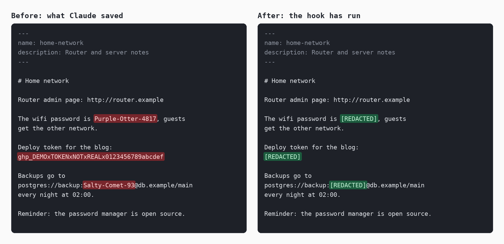

<p align="center"></p>

# claudepassredactor

**English** | [Español](README.es.md)

A hook for [Claude Code](https://code.claude.com/docs) that replaces passwords and tokens with `[REDACTED]` in its memory notes. If you give Claude a password and it ends up saved in a `.md` memory file, the hook masks it, there and in every other note.

It is one Python file with no dependencies. It stores only keyed fingerprints of what you type, never the text. It is an independent project, not affiliated with or endorsed by Anthropic.

> **This is a safety net, not a vault.** It removes secrets from memory notes after they get there. By then the secret has already gone through your conversation and is in the transcript. If a secret matters, change it. See [What it does not guarantee](#what-it-does-not-guarantee).

## What it replaces

Only in Markdown files inside memory folders:

| What | Example | When |
|---|---|---|
| Secrets you gave in a message, recognised there by label or format | `Hunter-2024x`, found later even with no label next to it | Strong values anywhere; PINs and short values only if a keyword like *password* or *PIN* comes a little earlier in the same sentence |
| Tokens with a known format | GitHub, GitLab, Anthropic, OpenAI, Stripe, Slack, Discord, AWS, Google, npm, PyPI, Hugging Face, SendGrid, Telegram, DigitalOcean, JWT, `Authorization` headers, PEM and PGP private keys | Always, even from sources other than your messages |
| Labelled values | `password: X`, `DB_PASSWORD=X`, `"password": "X"`, table cells, `API_KEY=X` | If X looks like a secret: at least 8 characters, mixing letters with digits or symbols, or 8 or more digits |
| URL passwords | `postgres://user:X@host`, `redis://:X@host` | If X is strong or at least 8 letters; `123456` from a manual stays unless you gave it |

**Languages.** Labels are recognised in 15 languages: English, Spanish, Portuguese, French, German, Italian, Dutch, Polish, Russian, Ukrainian, Simplified Chinese, Japanese, Korean, Thai and Hindi. For example *mot de passe : X*, *Das WLAN-Passwort lautet X*, *пароль — X*, *密码是X*, *パスワードはXです*, *비밀번호는 X입니다*, *รหัสผ่านคือ X*, *मेरा पासवर्ड X है*. Messages from the hook and the commands use the same languages.

**Left alone on purpose:** "the password is incorrect", "password manager: Bitwarden7", `password: <your-password>`, `${DB_PASS}`, names of environment variables, paths, versions, IP addresses, dates, ordinary words, and any file that is not Markdown.

## What it does not guarantee

- **The secret has already travelled.** Your message reached the model provider, and it is in the conversation transcript (`.jsonl`), which this tool does not touch. Masking a note does not unsend anything.
- **Copies elsewhere stay.** Backups, sync services, git history, other files and other folders keep what they already have. If your memory folder is a git repository, old commits still hold the secret.
- **There is a delay.** A note is masked right after a file tool writes it, or at the next shell command or message otherwise. Until then the secret is on disk, and Claude may have read it.
- **Detection is heuristic.** It will miss things. See [Limitations](#limitations).
- **Fingerprints are not encryption.** With both the key and the fingerprints, an attacker can test guesses offline, and a 4-digit PIN falls at once. They live in a private folder for that reason; do not sync or commit it.
- **Redaction cannot be undone.** The original value is not stored anywhere. Run `scan` first if you are unsure, and keep your own backup of anything you would miss.

## Install

You need Python 3.9 or newer. The hook never sends anything over the network.

**1. Get the file and copy it.** It is in the repository at <https://github.com/javimentallab/claudepassredactor>: clone it, or download `claudepassredactor.py` alone.

```sh
git clone https://github.com/javimentallab/claudepassredactor
cd claudepassredactor
mkdir -p ~/.claude/hooks
cp claudepassredactor.py ~/.claude/hooks/
```

On Windows, copy it to `C:\Users\<you>\.claude\hooks\`.

**2. Register the hooks** in `~/.claude/settings.json`, merging with any `hooks` you already have. Use the full path to the file, and `python` instead of `python3` on Windows, here and in the commands below:

```json
{
  "hooks": {
    "UserPromptSubmit": [
      {
        "hooks": [
          { "type": "command", "command": "python3 -I /home/you/.claude/hooks/claudepassredactor.py prompt", "timeout": 20 }
        ]
      }
    ],
    "PostToolUse": [
      {
        "matcher": "Write|Edit|MultiEdit|Bash|PowerShell",
        "hooks": [
          { "type": "command", "command": "python3 -I /home/you/.claude/hooks/claudepassredactor.py memory", "timeout": 20 }
        ]
      }
    ]
  }
}
```

On Windows, write the path with forward slashes: `python -I C:/Users/<you>/.claude/hooks/claudepassredactor.py prompt`. Claude Code runs the command through Git Bash, which removes backslashes outside quotes, so the hook looks for a file that does not exist even if yours does. Inside double quotes a path with backslashes worked when tested, but `status` warns about any backslash all the same.

**If the path is wrong, your messages are blocked.** Python cannot open the file and exits with code 2, and Claude Code blocks the message on that code. Nothing reaches Claude, and the same happens with every message, so you cannot use Claude Code until you correct `settings.json`. You recognize it by this text in place of an answer, as `claude -p` printed it on Windows with Claude Code 2.1.316, with exit code 0:

```text
UserPromptSubmit operation blocked by hook:
[python -I "C:/wrong/path/claudepassredactor.py" prompt]: C:\Python311\python.exe: can't open file 'C:\\wrong\\path\\claudepassredactor.py': [Errno 2] No such file or directory


Original prompt: your message
```

To fix it, open `~/.claude/settings.json` in a text editor, correct the path and start Claude Code again; it cannot make the change for you while your messages are blocked. Then run `status` from a terminal: it warns about a backslash and about a file that does not exist.

`-I` stops Python from loading modules from the current folder or from `PYTHON*` variables, so a planted file cannot run inside the hook.

**3. Check it**

```sh
python3 ~/.claude/hooks/claudepassredactor.py status   # folders, key, fingerprints, hook paths
python3 ~/.claude/hooks/claudepassredactor.py scan     # what it would change today; changes nothing
```

The key is created on the first message. To mask what is already in your notes, run `redact` once you are happy with what `scan` lists.

**Optional:** to also review notes when a session starts, add a `SessionStart` entry with the same command as `PostToolUse` (mode `memory`) and no matcher.

## Uninstall and revert

1. Remove its entries from `~/.claude/settings.json`. Do this first: while the `prompt` hook's file is missing, Claude Code blocks your messages.
2. Delete `~/.claude/hooks/claudepassredactor.py`.
3. Delete its data, including the key: `~/.claude/claudepassredactor/`, and the shared file if you set `CLAUDEPASSREDACTOR_SHARED`.

Your notes stay as they are. **Text already replaced with `[REDACTED]` does not come back**, because the tool never kept it: restore from your own backup if you need it. To stop masking one value without uninstalling, run `forget`, which asks for the value at a hidden prompt. It does not restore notes already changed.

## How it works

```
your message ──► prompt hook ──► looks like a secret? ──► stores HMAC-SHA256 only
                                                          (key.bin stays on this machine)
                     │
                     ▼
Claude writes a note ──► memory hook ──► review ──► replaces matches in place, atomically
```

- **Fingerprints.** A secret from your message is stored as an HMAC-SHA256 with a random 256-bit key. To find it later, the review hashes the candidates at each word edge of a changed note, for each stored length.
- **Where things live.** By default in `~/.claude/claudepassredactor/`, outside the memory folders: `key.bin`, `fingerprints.json`, `state.json`, `redactor.log`. The folder and files are private to your user: mode `0700`/`0600`, or an equivalent ACL on Windows.
- **Which folders.** Every `~/.claude/projects/*/memory`, `~/.claude/agent-memory`, and `autoMemoryDirectory` from your **user** settings. Project settings files are deliberately not read, so that a cloned repository cannot point the tool at other folders through that option. (A repository you have trusted can already run its own hooks, so this is not a sandbox.) If you set that option in a project, list the folder in `CLAUDEPASSREDACTOR_DIRS`.
- **Writes are atomic.** A note is written to a temporary file, flushed, then swapped in. If anything fails, the original stays whole and the next pass tries again. There is no fallback that writes in place.
- **A running hook never blocks you.** It always exits 0. Problems go to the log and appear once as a short warning asking you to run `status`. A wrong path is different: the hook never starts, and Claude Code blocks your messages. See [Install](#install).
- **The log holds no data.** It records counts, file names, line numbers and kinds of match; for errors, only type, code and line.

## Commands

```sh
python3 claudepassredactor.py scan            # list matches, never the values; exit code 1 if any, 2 if there is a warning or an unreadable note
python3 claudepassredactor.py scan --context  # also each line, with every match masked
python3 claudepassredactor.py scan --all      # including hidden folders, except .git
python3 claudepassredactor.py redact          # review every note now
python3 claudepassredactor.py redact --all    # including hidden folders, except .git
python3 claudepassredactor.py status          # folders, key health, fingerprints, hook paths
python3 claudepassredactor.py add             # remember a value, typed at a hidden prompt
python3 claudepassredactor.py forget          # stop looking for a value
python3 claudepassredactor.py reset --yes     # delete the key and this computer's fingerprints, not the shared file
```

`scan` and `redact` look at the same notes: by default they skip hidden folders, as the hooks do, and `--all` includes them.

`add` is the way to protect a value **without telling Claude**, or one the detection misses, such as a passphrase with spaces. `scan --context` prints the rest of each line: a secret it did not recognise would appear there, so read that output yourself rather than pasting it into a conversation.

| Variable | Meaning |
|---|---|
| `CLAUDEPASSREDACTOR_DIRS` | Folders to review, as absolute paths, separated by `:` (`;` on Windows). Replaces the defaults. A drive, your home folder or the Claude folder itself is refused, with a warning. |
| `CLAUDEPASSREDACTOR_DATA` | Where the key, fingerprints, state and log live, as an absolute path. |
| `CLAUDEPASSREDACTOR_SHARED` | File that keeps fingerprints in step between computers, as an absolute path. Off by default. |
| `CLAUDEPASSREDACTOR_LANG` | Language of the messages, such as `de` or `zh-CN`. By default, from the system. |
| `CLAUDE_CONFIG_DIR` | Claude's folder, if not `~/.claude`. |

**Where to set them.** In the `env` block of `~/.claude/settings.json`, so that Claude Code passes them to the hooks:

```json
{
  "env": {
    "CLAUDEPASSREDACTOR_SHARED": "/home/you/sync/claudepassredactor.json"
  }
}
```

The commands you run yourself in a terminal do not read that block: to give them the same settings, define the variables there too.

**Several computers.** Each installation has its own key and fingerprints, so a secret typed on one is unknown to the others; format and label detection still work everywhere. To share them, copy `key.bin` to each computer by a private route, and point `CLAUDEPASSREDACTOR_SHARED` at the same file on all of them, in a folder that a tool of your own keeps in step, such as Syncthing. Do not use a folder that syncs to a third party, and do not put the key there: with the key and the fingerprints together, an attacker can test guesses. Syncthing's conflict copies are merged and removed, `forget` reaches the other computers, and a file made with another key is left alone and reported by `status`. `reset` does not delete the shared file, because the other computers use it, and says so; to keep sharing, copy `key.bin` back from another computer.

## Limitations

- Only `.md` files, and only inside memory folders. Links inside a memory folder are not followed, so a note reached through a link is not reviewed unless its real location is in a memory folder too.
- **Words alone are not recognised** unless quoted: "the password is sunshine" looks the same as "the password is incorrect". Use quotes, or `add`.
- **Passphrases with spaces** are not recognised by themselves. Use `add`.
- A label and its value must be on the same line, close together. "Hunter2024 is the password" is not recognised, except in Hindi, where that word order is the normal one.
- A value is found only as a whole word: not inside a longer one, not encoded (Base64, URL-encoded), and not split across lines. A password that itself contains `;name=` looks like the next field of a connection string, and what follows is left visible.
- A cut-off private key is masked only as far as its lines look like a key, so nothing else is lost; lines shorter than 16 characters may stay visible.
- A PIN is matched only a little after a keyword in the same sentence, so "4471 is my PIN" stays. This is what keeps "Room 4471" safe.
- Secrets that reach a note without ever being in your messages depend on format and label detection alone.
- A short window remains while Claude writes a note during a review: the tool rechecks the file just before replacing it, and a rewrite in that last instant could be lost. Claude Code's Edit tool refuses to work on a file that changed, and the hook tells Claude to read it again.
- A replaced note gets a new file: its mode is kept on Linux and macOS, but the owner becomes the user running the hook, a custom ACL on Windows is replaced by the folder's, and any other hard link to the file keeps the old content.
- Notes over 4 MiB and binary files are reported, not read. A hook spends at most about 10 seconds reviewing; a note that alone takes longer is reported and left for `redact`, which has no limit. Legacy encodings keep every byte, but non-ASCII secrets may not match in them.
- Hook messages, command messages and detection are translated; `--help` and `status` are in English only.
- Translations were written by the author with AI assistance. Corrections are welcome, especially false positives in any language.

## Tests

```sh
python run_tests.py
```

Standard library only. It runs in a temporary folder deleted at the end, with invented secrets, and it redirects `HOME`, `USERPROFILE` and `CLAUDE_CONFIG_DIR` before importing the tool, so it cannot reach a real memory folder. The summary shows results per language.

## Contributing

See [CONTRIBUTING](CONTRIBUTING.md). To report a security problem privately, see [SECURITY](SECURITY.md).

## License

[MIT](LICENSE). No third-party code or runtime dependencies. `tools/render_illustration.py`, which draws the image above, needs Pillow, but only to regenerate it: see [NOTICE](NOTICE).
